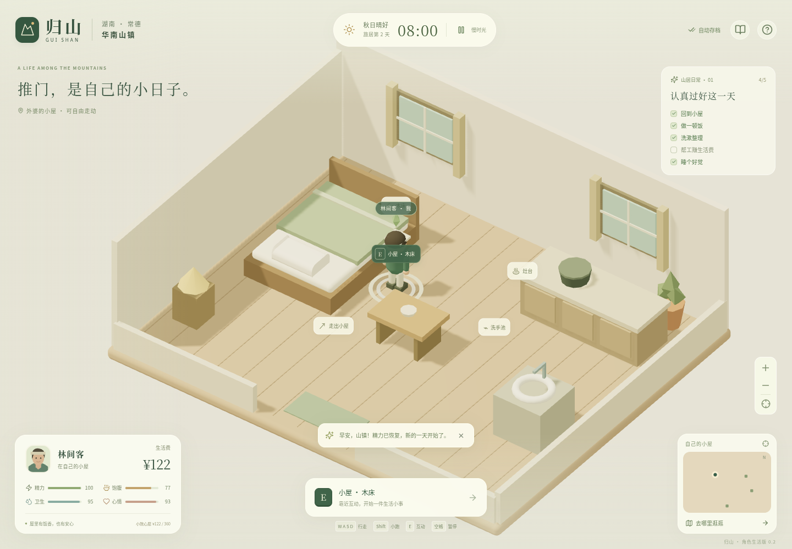

# 归山 · 华南山镇 0.2

以湖南常德风物为灵感的单机 3D 生活模拟原型。玩家操控「林间客」，走过老街、回到小屋、做饭洗漱、坐下吃米粉、到木作坊帮工，与有自己日常作息的刘阿婆和周师傅慢慢熟悉。

地图是原创山镇布局，「华南山镇」为游戏内地名。人物、房屋、家具、山林和溪水均由代码生成，不依赖外部模型、在线字体、地图 API 或后端。



## 下载试玩

**[下载角色生活版试玩包](downloads/guishan-playable.zip?raw=1)**

解压后，用电脑 Chrome 或 Edge 打开 `guishan-standalone.html`。脚本、样式和图标全部内嵌，无需安装 Node.js 或启动服务。手机浏览器对下载 HTML 的支持各不相同；需要稳定的手机网址时应另行部署网站。

存档保存在当前浏览器。本地文件是否允许存档取决于浏览器设置；无法保存时会提示。请保留 HTML 的文件名与位置以继续进度。

## 怎么操作

| 操作           | 方式                                               |
| -------------- | -------------------------------------------------- |
| 行走           | WASD / 方向键；手机左侧虚拟摇杆                    |
| 小跑           | Shift，精力或饱腹过低时会减速                      |
| 自动步行       | 点击地面、建筑标签、小地图或地点导航               |
| 靠近互动       | E；手机右侧「互动」按钮                            |
| 镜头           | 右键旋转、滚轮缩放；手机双指调整；跟随按钮回到人物 |
| 暂停           | 空格 / P / 顶部暂停按钮                            |
| 取消活动或行走 | Esc；也可使用对应的取消按钮                        |

人物不能穿过房屋或溪水，过溪需要走石桥。自动寻路遵循相同的碰撞规则；手动移动会取消原来的行走路线。挡住玩家的前景房屋和树木会暂时半透明。

## 过一天山居生活

1. 在外婆的小院门口按 E，选择「推门进入小屋」。
2. 走到灶台做饭、到洗手池洗漱，精力不足时到床边睡觉。
3. 出门去阿婆米粉铺坐下吃饭，去周记木作坊帮工赚生活费。
4. 靠近刘阿婆或周师傅聊天，每天首次聊天增加 8 点关系。
5. 夜晚回家睡觉，次日 08:00 醒来。顶部的五项日常清单可引导第一次游玩。

活动包含持续动画，完成后才结算费用、需求变化和报酬。取消或中途刷新不会提前获得收益，也不会扣费。家常饭花费 ¥6，米粉花费 ¥18，木工收入 ¥68，采茶收入 ¥45；生活费耗尽时仍可在家用余粮免费煮清粥。

精力、饱腹、卫生和心情随游戏时间变化，进食、洗漱、休息会恢复相应需求。空格暂停；隐藏页面时暂停时间推进。21:00 后需要回家睡觉再安排新的活动。

阿婆在 08–12、14–19 时开店，周师傅在 08–12、14–18 时做工。中午两人会沿道路前往老树广场，晚上回家；休息期间不能在店里获得服务或报酬。人物关系与日常经历记录在手账中。

## 开发与构建

需要 Node.js 22.18+（推荐 Node.js 24）和 npm。在现有项目目录执行：

```sh
cd /workspace/hello-world
npm ci
npm run dev
```

```sh
npm run build           # TypeScript 检查 + 普通生产构建
npm run preview         # 预览 dist
npm run pack:playable   # 生成单文件 HTML、试玩 ZIP 和 SHA-256 校验文件
```

生成的 HTML 位于 `dist/guishan-standalone.html`，试玩包同时输出至 `dist/` 和已纳入 Git 的 `downloads/`。仅执行普通构建会刷新 `dist/`；需要交付下载包时执行 `pack:playable`。

云机器里的 5173 端口不会自动成为公网地址。在自己电脑访问 `localhost:5173` 只会连接自己的电脑。云环境暂停或重启后需重新启动开发进程；发布开发环境快照与发布公开网站是两件事。

## 验证

```sh
npm test                  # 16 项规则、移动、碰撞、寻路、日程和存档测试
npm run test:e2e          # 桌面与手机完整游玩、摇杆松手、暂停、旧存档与二维降级
npm run pack:playable
npm run test:standalone   # 相同单文件在断网后运行、进屋做饭与刷新存档
```

浏览器测试默认使用 `/usr/bin/chromium`，其他位置可设置 `CHROMIUM_PATH`。测试使用隔离上下文，不修改已有玩家的存档，截图写入被 Git 忽略的 `test-results/`。

当前受管 Chromium 禁止直接导航到 `file://`，单文件测试通过临时本机服务载入同一个 HTML 后断网执行，验证没有外部资源请求；不宣称在该环境中自动化验证了本地双击打开。

## 存档与范围

新版保存至 `guishan-life:v2`，首次启动会自动迁移旧版 `guishan-life:v1` 的生活费、天数、手账和小院修缮状态。人物位置、四项需求、关系和日常清单均保存。进行中的活动不写入存档，重新打开视为取消。无 WebGL 时提供使用相同移动与互动规则的二维导览。

当前是一个可操控角色的生活模拟原型，包含一间可进入的小屋、米粉铺、木作坊、两位按作息行走的 NPC，以及既有的茶园、杂货铺和溪畔地点。暂未包含家具自由摆放、完整职业/家庭系统、多角色控制、联机或云存档。

## 主要代码

- `src/world.ts`：碰撞、互动点、A\* 路径和 NPC 作息。
- `src/simulation.ts`：持续行走、活动进度、靠近验证、结算与 NPC 移动。
- `src/game.ts`：需求、金钱、关系、日常记录和旧版存档迁移。
- `src/LifeScene.tsx`：可操控人物、关节动画、跟随镜头、可进入小屋与遮挡淡化。
- `src/TownScene.tsx`：原有山镇、建筑、茶园、石桥与植被。
- `src/App.tsx`、`src/life.css`：游戏循环、键盘/触摸输入、人物 HUD 与日常界面。
